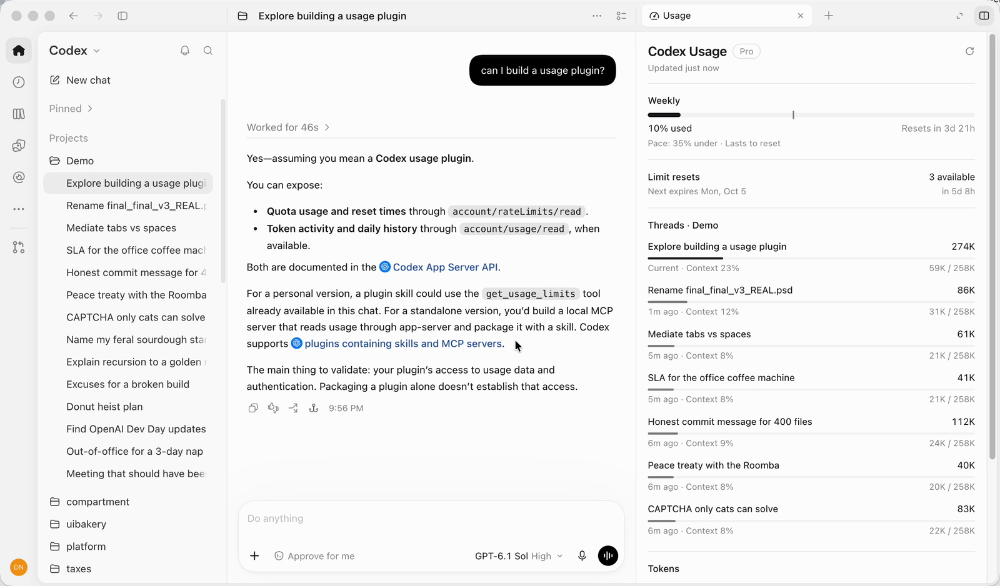
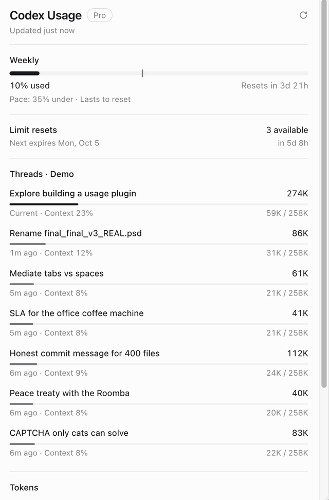

# Codex Usage

A Codex plugin that shows your rate limits, reset times and token usage right next to your threads. Built on OpenAI [plugin extensions](https://developers.openai.com/plugins/build/extensions).



## What it shows



- **Limits.** Every window (5-hour, weekly, model-specific) with percent used, time to reset, an even-use marker, and pace: `Pace: 35% under · Lasts to reset` or `Runs out in 1d 4h`.
- **Limit resets.** Available reset credits and when the next one expires.
- **Threads.** The current thread and recent threads from the same project, with tokens and context fill. Click one to open it.
- **Tokens.** Today, the last 7 and 30 days, and a 30-day chart.
- **OpenAI status.** Open incidents from status.openai.com.

Open it from:

- a thread's side panel: `+` → **Usage**;
- the sidebar: **Usage** (adds a 30-day chart and the heaviest threads of the week);
- the chat: `@Usage how much of my limit is left?`

<br clear="right">

## Install

Requirements: the ChatGPT desktop app with Codex, and Node.js 22.5+ on your `PATH`. Tested on macOS.

```sh
codex plugin marketplace add nnixaa/codex-usage-plugin
codex plugin add usage@codex-usage
```

Quit and reopen the app, then open any thread and add **Usage** from the side panel's `+` menu.

Update:

```sh
codex plugin marketplace upgrade codex-usage
codex plugin add usage@codex-usage
```

Codex keeps plugin servers running across reinstalls, so quit and reopen the app after updating.

Remove:

```sh
codex plugin remove usage@codex-usage
codex plugin marketplace remove codex-usage
```

## Privacy

Everything runs on your machine. The plugin reads:

- rate limits through your local `codex app-server` (`account/rateLimits/read`). It never touches Codex credentials;
- `token_count` events from `~/.codex/sessions` and `~/.codex/archived_sessions`;
- thread titles and token totals from `~/.codex/state_5.sqlite`, read-only.

The only network request goes to the public `status.openai.com` page. Small cache files live in your OS cache directory (`~/Library/Caches/codex-usage-plugin` on macOS). No telemetry.

## Development

```sh
npm install
npm run build        # bundles the plugin into plugins/usage
npm run smoke        # starts the built server and calls every tool
codex plugin marketplace add .
codex plugin add usage@codex-usage
```

`src/server` is the MCP server; `src/app` is the UI rendered by Codex. `preview/index.html` is a minimal MCP Apps host for working on the UI in a browser: run `node scripts/snapshot.mjs [threadId]` to capture real tool results, then serve the repository root and open `/preview/`.

Codex starts one plugin server per open thread; they share limits through a small cache file, and the `codex app-server` child exits 15 seconds after each read.

## Limitations

- Codex only.
- The sidebar entry opens inside a helper thread that Codex creates and discards.
- Entry points use the server icon: the MCP SDK does not yet accept per-tool icons.
- Linux and Windows paths are handled but untested.

## License

[MIT](LICENSE)
